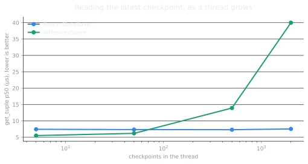
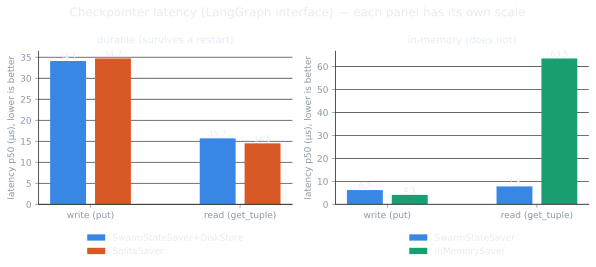
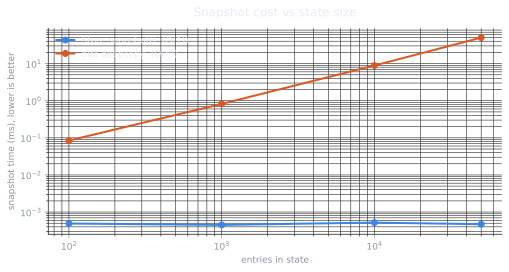

# Benchmarks

Every number here is **reproducible** - run
[`benchmarks/run.py`](https://github.com/swarmstate/swarmstate/blob/main/benchmarks/run.py)
yourself:

```bash
pip install "swarmstate[langgraph,disk]" langgraph-checkpoint-sqlite matplotlib
# or: uv add "swarmstate[langgraph]" langgraph-checkpoint-sqlite matplotlib
python benchmarks/run.py --iters 5000 --seed 7
```

!!! warning "Read the setup before comparing"
    - **Release build** (published wheels / `maturin develop --release`). Debug builds
      are several times slower.
    - **Durable is compared with durable.** A checkpointer that survives a restart does
      strictly more work than one that does not, so the two groups below are kept apart:
      `SwarmStateSaver` over [`DiskStore`](guide/disk.md) against `SqliteSaver` (both
      SQLite files in WAL mode), and `SwarmStateSaver` against `InMemorySaver` (neither
      persists). Earlier revisions of this page paired an in-memory store against a
      file-backed one and reported the gap as a speedup; that measured the price of
      persistence, not an implementation.
    - **Same fsync policy, or say so.** `DiskStore` runs `synchronous=NORMAL`;
      `SqliteSaver` ships `synchronous=FULL`. Both appear below, so "faster" is never
      confused with "weaker durability".
    - Warm cache, single process, no competing load. Percentiles are of individual calls,
      not an average of a batch. Hardware/versions below.

## Reading the latest checkpoint, as a thread grows

{ width="720" }

This is the operation every resume performs. A saver that finds the newest checkpoint by
scanning the thread's keys gets slower as the conversation lives; one that looks it up does
not:

| checkpoints in the thread | `SwarmStateSaver` | `InMemorySaver` |
| --- | --- | --- |
| 5 | 7.4 µs | 5.5 µs |
| 50 | 7.3 µs | 6.2 µs |
| 500 | 7.3 µs | 13.9 µs |
| 2 000 | **7.5 µs** | 40.0 µs |

Flat against rising. At five checkpoints the reference saver is *faster*; by two thousand
it is five times slower, and the gap keeps widening. swarmstate resolves "latest" by
lookup — an O(1) pointer for in-memory stores, an indexed `max(key)` on the SQL backends —
instead of scanning. This is the difference that shows up in a long-running deployment,
and it is the number worth quoting.

## Checkpoint latency, durable

{ width="720" }

Both are SQLite files in WAL mode. The first two rows share the same `synchronous=NORMAL`
fsync policy; the third is `SqliteSaver` as it ships, a stronger guarantee:

| Checkpointer | `put` p50 | `put` p99 | `get_tuple` p50 |
| --- | --- | --- | --- |
| **`SwarmStateSaver(DiskStore(...))`** · `synchronous=NORMAL` | **34.1 µs** | 87.6 µs | 15.7 µs |
| `SqliteSaver` · same `synchronous=NORMAL` | 34.7 µs | 75.6 µs | 14.5 µs |
| `SqliteSaver` · shipped `synchronous=FULL` | 63.9 µs | 211.9 µs | 14.4 µs |

Durable writes are **on par** with `SqliteSaver` at a matched fsync policy (1.02×), and
about **1.9× faster** than its shipped default — which buys stronger durability, not
nothing.

## Checkpoint latency, in-memory

Neither of these survives a restart:

| Checkpointer | `put` p50 | `put` p99 | `get_tuple` p50 |
| --- | --- | --- | --- |
| `SwarmStateSaver` | 6.2 µs | 11.7 µs | **7.8 µs** |
| `InMemorySaver` | **4.1 µs** | 7.5 µs | 63.5 µs |

Writes are **slower** here (0.66×): swarmstate serializes state to msgpack bytes on the
way in, which is exactly what makes it portable across frameworks and snapshots O(1).
Reads are 8× faster at this thread length — and, per the first table, that factor is a
function of how long the thread has been running.

## Snapshot cost vs state size

{ width="720" }

`Store.snapshot()` is **O(1)** (persistent data structure + a running byte counter), so
it stays flat as state grows, while `copy.deepcopy` is O(n):

| entries | `Store.snapshot()` | `dict` deepcopy | ratio |
| --- | --- | --- | --- |
| 100 | 0.00049 ms | 0.085 ms | ~170× |
| 1,000 | 0.00045 ms | 0.82 ms | ~1,800× |
| 10,000 | 0.00052 ms | 8.9 ms | ~17,000× |
| 50,000 | 0.00047 ms | 50.2 ms | **~107,000×** |

Diffing two snapshots shares the same property: untouched shards and namespaces are
literally the same structure in both, so a diff costs the *changes* and not the size of
the store — 11 µs over 2 000 namespaces with one changed entry.

This is what makes [time-travel over the whole checkpoint DB](tutorials/langgraph.md)
practically free.

## Concurrency (free-threaded vs GIL)

The store shards its write locks and releases the GIL on the hot paths. On a
**free-threaded (no-GIL) CPython build** the same code does not serialize behind the
interpreter lock. Median of 5 runs, set+get, distinct namespaces per thread:

| Build | 1 thread | 8 threads | 8-thread vs GIL |
| --- | --- | --- | --- |
| CPython (GIL) | ~1.8M ops/s | ~130k ops/s | baseline |
| Free-threaded (`cp313t`) | ~2.2M ops/s | **~1.8M ops/s** | **~14x** |

!!! warning "It's about not collapsing, not linear scaling"
    This workload is **allocation-bound** (msgpack buffers, Python result objects), so it
    does **not** speed up with more cores on *either* build. The difference is the shape:
    under the GIL, adding threads makes it dramatically **slower** (it collapses); the
    free-threaded build holds throughput roughly flat, so at 8 threads it does about **10x**
    the GIL build. Single-threaded, free-threaded is ~2x (no per-call GIL machinery). The
    free-threaded win needs a `cp313t` interpreter, for which swarmstate ships
    version-specific wheels. See [Architecture](architecture.md#free-threaded-no-gil).

Batching helps independently: on the free-threaded build at 8 threads, `set_many` (batches
of 50) reaches roughly **3x** the throughput of individual `set`s.

## Environment

| | |
| --- | --- |
| Machine | Apple Silicon (macOS, arm64) |
| Python | 3.14 |
| swarmstate | 0.11.0 (release build) |
| langgraph | 1.2.x · langgraph-checkpoint 4.x · langgraph-checkpoint-sqlite 3.x |
| iters / warmup | 3,000 / 300 · seed 7 |

Numbers vary by hardware - regenerate on yours with the command above.
