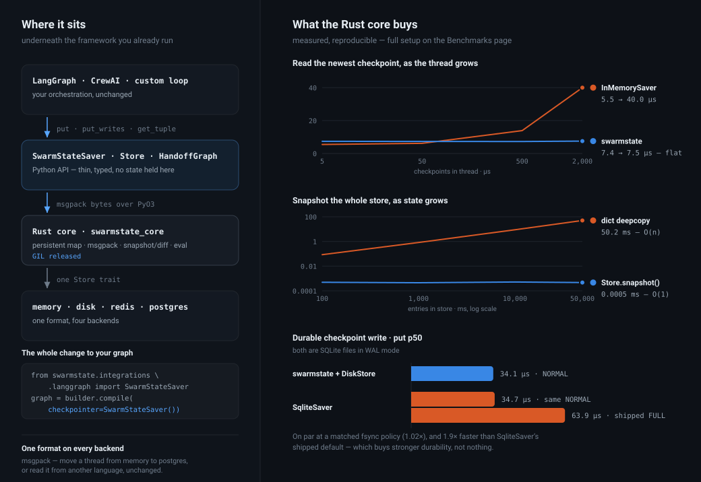

---
hide:
  - navigation
  - toc
---

<div class="ss-hero" markdown="1">

# swarmstate

<p class="ss-tag">Drop-in state backend for LangGraph, CrewAI &amp; custom agent loops -
Rust core, framework-agnostic, built for production.</p>

<div class="ss-install" markdown="1">
<code>pip install swarmstate</code>
<code>uv add swarmstate</code>
</div>

<div class="ss-cta" markdown="1">
[Get started](guide/store.md){ .md-button .md-button--primary }
[GitHub](https://github.com/swarmstate/swarmstate){ .md-button }
</div>

</div>



<p class="ss-stack-cap">Where swarmstate sits: underneath your orchestration framework, as the fast state &amp; checkpointing engine.</p>

<div class="ss-features" markdown="1">

<div class="ss-card" markdown="1">
### No state lock-in
A framework-agnostic store with a stable, language-neutral (msgpack) format.
Migrate between frameworks without losing accumulated state.
</div>

<div class="ss-card" markdown="1">
### Fast checkpointing
A Rust core with fast serialization, O(1) immutable snapshots and incremental
diffs. The GIL is released on the hot paths.
</div>

<div class="ss-card" markdown="1">
### Deterministic routing
Rule-based "which agent is next" decisions resolved natively in Rust - no LLM
tokens spent on transitions you can express as rules.
</div>

</div>

---

`swarmstate` does not compete with visible agent frameworks; it acts as low-level
infrastructure, much like engines such as DuckDB, ClickHouse, Arrow, or Polars can sit
underneath data applications without replacing them.

See the [Guide](guide/store.md) to get started, or the [API reference](api.md) for the
full surface.

## Citing

If you use `swarmstate` in academic work, please cite it. GitHub's **"Cite this
repository"** button (from
[`CITATION.cff`](https://github.com/swarmstate/swarmstate/blob/main/CITATION.cff))
produces ready-made APA and BibTeX entries. To cite the archived software release, use
its Zenodo DOI (`10.5281/zenodo.XXXXXXXX`):

```bibtex
@software{salmeron_swarmstate,
  author    = {Salmeron, Jose L.},
  title     = {{swarmstate}: A state and checkpointing backend for multi-agent
               systems with a Rust core},
  year      = {2026},
  publisher = {Zenodo},
  doi       = {10.5281/zenodo.XXXXXXXX},
  url       = {https://github.com/swarmstate/swarmstate}
}
```
